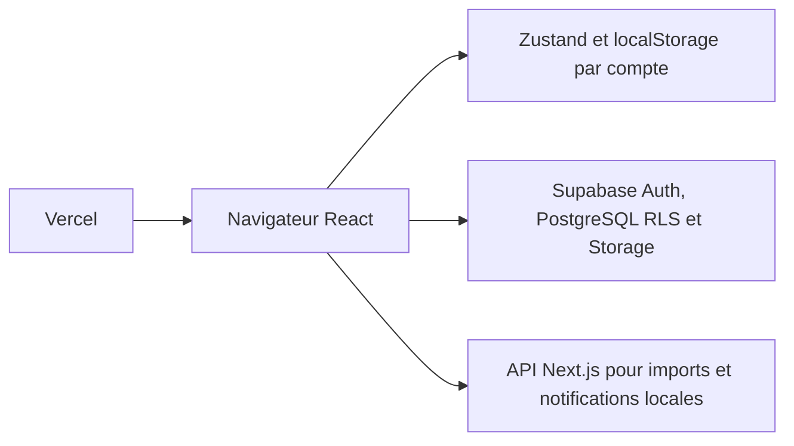

# Broco-Chou

**Objectif :** Découvrir le projet et lancer un environnement local sûr.
**Dernière mise à jour :** 2026-10-17
**Statut :** Audit initial de `main/e89d109`, documentation consolidée et livrée sur `main` ; suivi dans le journal de session.
**Documents liés :** [PRD](docs/PRD.md), [TRD](docs/TRD.md), [Parcours](docs/APP_FLOW.md), [Design](docs/DESIGN_BRIEF.md), [Backend](docs/BACKEND_SCHEMA.md), [Roadmap](docs/ROADMAP.md), [Décisions](docs/DECISIONS.md).

Broco-Chou aide à choisir des recettes, composer sept jours de repas et préparer ses courses. Pensé pour les étudiants et la cuisine du quotidien, ce projet indépendant s'inspire des calendriers du Crous de Lyon ; il n'est pas un service officiel du Crous.

[Application publique](https://recipe-app-alpha-wine.vercel.app) · [Dépôt GitHub](https://github.com/LordVERTON/recipe-app)

## Fonctionnalités

- Découverte par swipe, sélection et favoris.
- Planning sur aujourd'hui à J+6, génération à partir des recettes choisies ou édition manuelle.
- Recherche et filtres dans l'éditeur, choix des créneaux et suivi des repas cuisinés.
- Courses regroupées, cases à cocher, copie, partage et impression.
- Comptes e-mail/mot de passe, confirmation Supabase, recettes personnelles et photos privées.
- Modération administrative ; workflow enrichi et droits des deux comptes attendus déployés dans Supabase Cloud le 2026-10-17, accès SQL/RLS vérifiés.

Plans, favoris, préférences, courses et historique restent dans le navigateur, séparément par compte. Comptes, recettes et photos sont dans Supabase.

## Stack et prérequis

Next.js 16.2.6, React 19.2.6, TypeScript 5.7.3, Tailwind CSS 4.3.0, shadcn/ui/Radix, Framer Motion, Zustand, Supabase JS 2.117.3 et CLI 2.120.0, PostgreSQL/RLS, Storage, Vercel. Versions résolues du lockfile ; détail dans le [TRD](docs/TRD.md).

Installer Node.js ≥22 et npm ; démarrer Docker Desktop pour Supabase local. L'installation initiale peut télécharger des images Docker.

## Démarrage local — PowerShell

Depuis la racine du dépôt :

```powershell
npm ci
npm run supabase:start
npm run supabase:env
npm run mailpit
npm run dev
```

Ouvrir [Next.js](http://localhost:3000), [Studio](http://127.0.0.1:54323) et [Mailpit](http://127.0.0.1:54324). Supabase API utilise 54321, PostgreSQL 54322. `supabase:start` démarre déjà Mailpit ; `mailpit` permet aussi de le relancer seul.

`supabase:env` écrit les clés de la pile locale dans `.env.development.local`, préserve `.env.local` et ne contacte pas Cloud. Redémarrer Next.js si déjà lancé. Les comptes locaux sont distincts des comptes de production ; les confirmations sont capturées par Mailpit. Le seed local autorise l'adresse d'administrateur de développement sans créer de compte ni mot de passe.

Le modèle [`.env.example`](.env.example) est l'unique exemple, sans secret. Ne jamais versionner les fichiers `.env*.local`. Sans Supabase configuré, les mocks permettent la découverte ; Auth et soumissions nécessitent Supabase. Une configuration Cloud éventuelle dans `.env.local` n'est pas remplacée pour le build de production local.

Pour un téléphone sur le même réseau privé :

```powershell
npm run dev:local -- --hostname 0.0.0.0
```

Ouvrir `http://<IPv4-du-PC>:3000`, adapter `allowedDevOrigins` et les redirections Auth locales, puis vérifier le pare-feu. Next.js relaie Supabase local via `/__supabase`. [Procédure et diagnostic](docs/TRD.md).

## Commandes importantes

| Commande | Usage |
| --- | --- |
| `npm run lint` | ESLint |
| `npx tsc --noEmit` | Contrôle de types séparé obligatoire : le build ignore les erreurs de types |
| `npm run build` puis `npm run start` | Construire et servir la version de production localement |
| `npm run supabase:stop` | Arrêter les services locaux en conservant leurs données |
| `npm run supabase:status` | Statut local ; peut afficher des clés, ne pas partager sa sortie |
| `npm run mailpit:stop` | Arrêter uniquement la boîte locale |
| `npm run mailpit:check` | Tester livraison et confirmation locales avec nettoyage |
| `node scripts/verify-personal-recipes.mjs` | Soumission, photos et droits dans la seule base locale |
| `node scripts/verify-documentation.mjs` | Sept documents, métadonnées et liens locaux |
| `npm run offline:check` | Détecter les ressources non autonomes ; échec connu sur les URLs Pexels des imports |

Autres tests, prérequis Playwright, résultats et échecs : [journal de validation](docs/ROADMAP.md). Pour une migration locale additive : `npm exec -- supabase migration up --local`. `npm run supabase:reset` détruit les données locales et rejoue les seeds : ce n'est pas une commande normale de démarrage. Ne jamais exécuter de reset distant.

## Architecture et déploiement



Vercel, projet `recipe-app`, équipe `vertondan-9283s-projects`, installe avec `npm ci`. Supabase Cloud : `cbwrvcifxcqyrgtcpvbd`. Les migrations sont distinctes du déploiement frontend. Aucun push ni déploiement de production sans accord ; travailler depuis `main`, relire le diff et les tests avant fusion.

Au 2026-10-17 : SMTP intégré Supabase confirmé en lecture seule, confirmation obligatoire et redirection publique correcte. Limites de destinataires/débit documentées dans [TRD](docs/TRD.md). `RESEND_API_KEY` existe dans Vercel Production/Preview sans usage dans le code ; retrait proposé, pas effectué. Mailpit est conservé, aucun Mailjet/Resend applicatif ajouté.

## Documentation de référence

| Document | Question traitée |
| --- | --- |
| [PRD](docs/PRD.md) | Pourquoi, pour qui et quelles fonctions réelles ? |
| [TRD](docs/TRD.md) | Comment construire, configurer, tester et exploiter ? |
| [APP_FLOW](docs/APP_FLOW.md) | Quels écrans, états et appels ? |
| [DESIGN_BRIEF](docs/DESIGN_BRIEF.md) | Quels tokens, composants et règles UX ? |
| [BACKEND_SCHEMA](docs/BACKEND_SCHEMA.md) | Quelles tables, RPC, permissions et divergences Cloud ? |
| [ROADMAP](docs/ROADMAP.md) | Quelles tâches, dettes, preuves et historique City Café ? |
| [DECISIONS](docs/DECISIONS.md) | Pourquoi ces choix et quelles propositions restent ouvertes ? |

## Limites et contributions

Pas de synchronisation multi-appareil, d'écran complet régime/budget, de récupération de compte dans l'UI ni de pipeline Odélis périodique. Quantités/portions, invalidation des courses, accessibilité et dépendances demandent encore des corrections. L'audit npm signale 12 alertes dont une critique. L'écart SQL de modération est corrigé par la livraison autorisée du 2026-10-17 ; aucun e-mail de modération n'est envoyé en production. Les validations et limites sont suivies dans la roadmap.

Pour contribuer : lire [AGENTS.md](AGENTS.md), partir de `main`, conserver Auth/RLS/données, utiliser Conventional Commits et mettre à jour documentation et journal avec les tests. Ne pas importer automatiquement `feat/auth-email-readiness`.

## Licence et attribution

Les références éditoriales Crous, URLs/pages sources et attributions Pexels doivent être conservées. Aucun fichier de licence générale du code n'est présent à la racine au moment de l'audit ; ne pas présumer une licence MIT ni des droits de republication des contenus tiers.

Sources : [Crous Lyon — Le plein d'idées recettes](https://www.crous-lyon.fr/se-restaurer/idees-recettes-a-refaire-chez-soi/), [Manger Bouger — Manger mieux](https://www.mangerbouger.fr/manger-mieux). Les [attributions City Café/Pexels](supabase/new-import/city-cafe-pexels-attribution.json) et les artefacts d'import restent versionnés.
