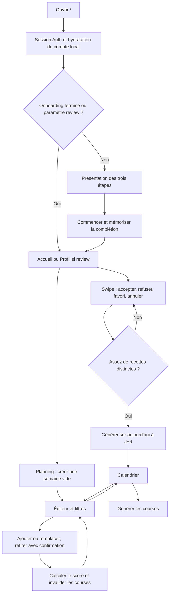
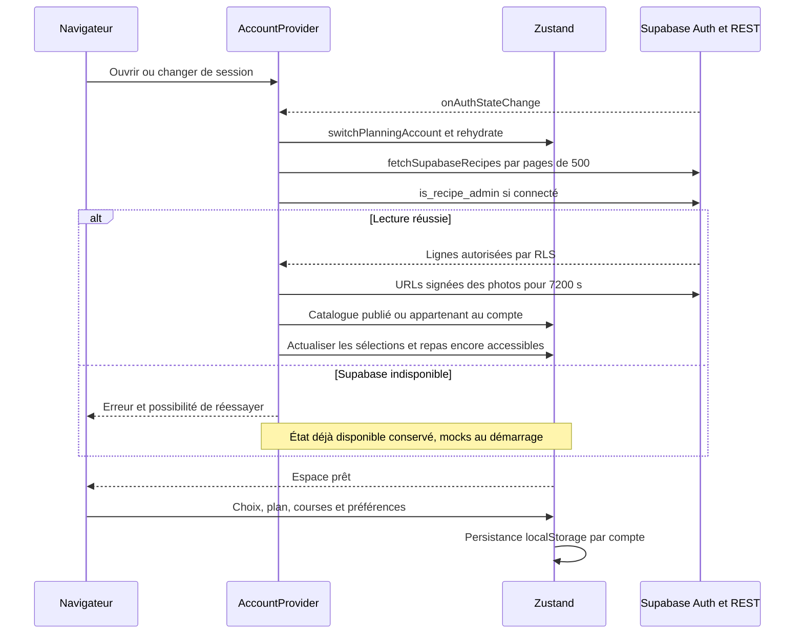
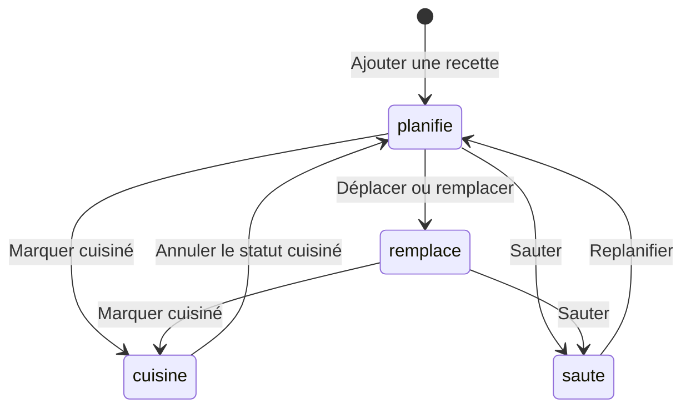
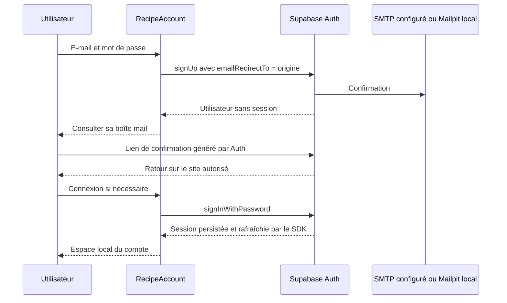
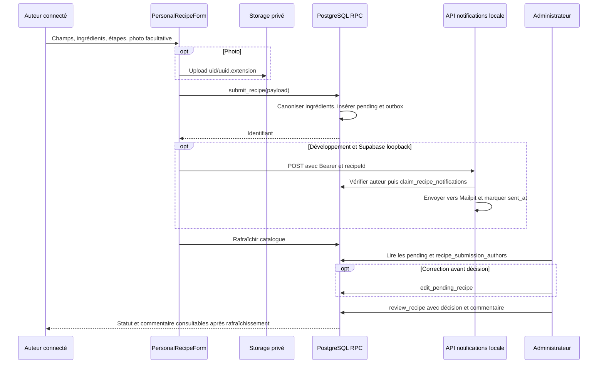
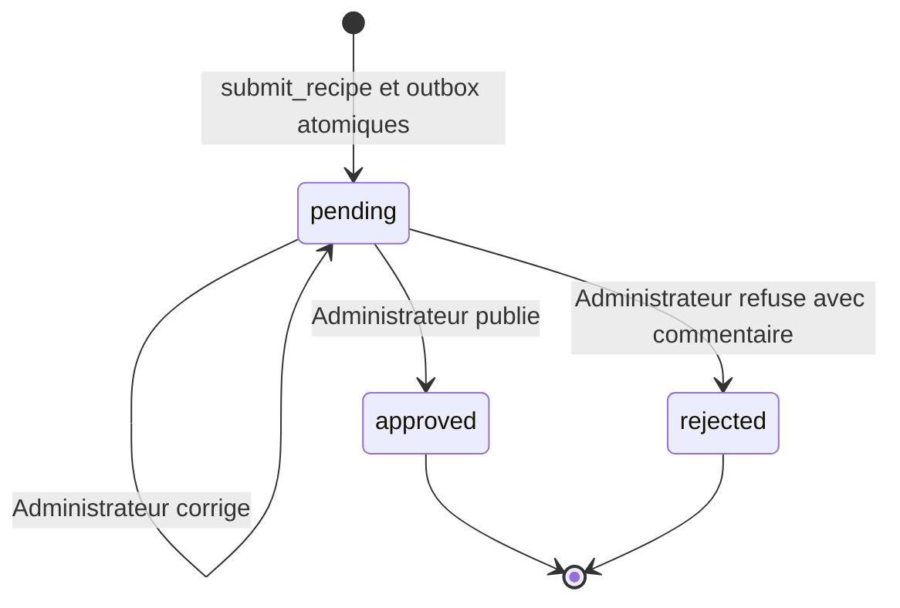

# Broco-Chou — Parcours et workflows

**Objectif :** Expliquer les écrans, appels et transitions effectivement implémentés.
**Dernière mise à jour :** 2026-10-17
**Statut :** EXISTANT, preuves de validation dans le journal de session.
**Documents liés :** [Produit](PRD.md), [Architecture](TRD.md), [Backend](BACKEND_SCHEMA.md), [Roadmap](IMPLEMENTATION_PLAN.md).

## Sitemap et navigation

| URL / méthode | Comportement et accès |
| --- | --- |
| `/` | `app/page.tsx` → `BrocoChouApp` → `AccountProvider`. Onboarding puis cinq onglets React : Accueil, Swipe, Planning, Courses, Profil. Ces onglets ne sont pas cinq routes |
| `/?review=<id>` | Ouvre le profil sans onboarding pour la connexion/modération ; le paramètre n'accorde aucun droit et ne sélectionne pas une fiche précise |
| `/admin/import` | Page d'import accessible sans garde Auth ; texte « Développement uniquement ». Seul l'enregistrement serveur est interdit en production |
| `POST /api/recipe-import/parse` | Analyse une légende collée, sans téléchargement Instagram et sans Auth |
| `GET /api/recipe-import/images?query=…` | Recherche six images dans les fichiers locaux, sans appel à Pexels |
| `POST /api/recipe-import/save` | Écriture avec clé serveur, refusée en production ; pas de contrôle de rôle en développement |
| `POST /api/recipe-notifications` | Jeton Auth et propriété de la recette obligatoires, transport Mailpit local |
| `GET /api/recipe-notifications` | Reprise manuelle avec `CRON_SECRET` ; aucun cron versionné |
| `/__supabase/:path*` | Réécriture Next.js uniquement en développement avec URL Supabase HTTP loopback, pas une API applicative |

Pas de `/login`, `/signup`, `/auth/callback`, `/privacy`, page publique par recette, sitemap dynamique ni route OAuth dans cette base. Le schéma exact des endpoints est dans [BACKEND_SCHEMA](BACKEND_SCHEMA.md).

## Première visite, découverte et planning

1. L'onboarding est une présentation, pas un questionnaire. La complétion est conservée dans l'espace local ; le changement d'identité conserve aussi la valeur courante avant hydratation.
2. La file de swipe est initialement mélangée et limitée à la saison si activée. Accepter et favori alimentent les choix ; favori alimente aussi les favoris. Refuser avance la file. Annuler enlève la dernière recette des trois listes. Les contrôles pendant l'animation évitent plusieurs avances simultanées.
3. Il faut sept recettes par créneau souhaité, avec un pool commun pour déjeuner/dîner. Le passage de complément peut proposer hors saison et reprendre des recettes refusées ; il exclut seulement les acceptées et vise les types manquants. Pas de recherche ni de filtres détaillés dans le swipe.
4. `generateWeeklyPlan` n'ajoute que des recettes explicitement acceptées. La génération utilise les créneaux du profil, saison/mois et variété des ingrédients ; elle n'appelle pas `scoreRecipe`.
5. L'éditeur permet une semaine vide sans attendre le swipe complet. Dates locales, aujourd'hui à J+6 au moment de la création ; le plan ne se décale pas chaque nuit. Recherche par titre, saison, durée, régime végétarien/poisson, équipement. Les choix ne sont pas filtrés par type de créneau. Une recette déjà planifiée ailleurs est exclue.
6. Chaque ajout/remplacement/retrait est enregistré immédiatement ; bouton « Voir mon planning » ferme l'éditeur. Le retrait demande confirmation et offre une annulation. Aucun archivage automatique de semaines n'est livré.

## Catalogue et propriété des états

Le catalogue complet et les ingrédients proviennent de Cloud/local selon configuration ; les RPC ne passent pas par une API Next.js intermédiaire. Sans configuration Supabase, le store garde les mocks. Sur erreur après chargement, le dernier état demeure : il ne s'agit pas d'un cache hors ligne complet ni d'une PWA. Un succès qui retourne zéro recette remplace le catalogue par un catalogue vide.

`AccountProvider.recipes` contient les lignes visibles à l'administrateur pour modération. Le store destiné à la planification reçoit seulement les recettes publiées ou celles de l'utilisateur. Le catalogue se rafraîchit au focus, toutes les 30 secondes pour un administrateur, toutes les heures sinon. Un compteur de génération écarte les réponses devenues obsolètes après changement de compte. La mise à jour des recettes purge les sélections et repas inaccessibles, et régénère les courses si une liste existe déjà.

## Consultation, cuisine, courses et historique

Ces états sont ceux de `PlannedMeal.status` ; le store accepte aussi les statuts typés via `updateMealStatus`. Le diagramme décrit les actions de l'interface, pas une contrainte PostgreSQL.

- La fiche affiche image, provenance et informations culinaires, ingrédients/étapes cochables, conseil éventuel et référence source/page. Les coches de préparation restent dans le composant, sans persistance.
- Depuis la fiche, « Ajouter au planning » ajoute à `acceptedRecipes` et ramène au swipe. Depuis « Mes recettes », l'action crée le plan si nécessaire puis ouvre l'éditeur avec le titre recherché.
- Marquer cuisiné ajoute une entrée d'historique uniquement à la transition vers `cuisine`. Revenir puis remarquer cuisiné peut créer une nouvelle entrée. Sauter ne crée pas une entrée `skipped` dans l'historique actuel.
- Déplacer conserve le créneau, remplace le repas qui l'occupait à destination et invalide la liste. Retirer/remplacer/ajouter/sauter invalident également les courses. Le retour de `saute` à `planifie`, la génération automatique d'un nouveau plan et le changement de nombre de personnes n'invalident pas toujours une liste existante : dette connue.
- La génération des courses parcourt tous les repas sauf `saute`, normalise les noms, regroupe selon les six catégories et multiplie les quantités par `householdSize`. Addition seulement pour les suffixes d'unité identiques ; sinon texte `x + y`. Pas de conversion kg/g, litre/ml ni correction par portions de recette.
- Les coches existantes sont conservées si la liste source est encore présente. Après invalidation à `[]`, elles sont perdues. Les basiques sel, poivre, huile, vinaigre, farine, sucre, moutarde, beurre, ail, oignon sont masqués à l'écran par défaut ; inclus dans copie/partage.
- Courses : copie presse-papiers, partage natif si disponible avec repli copie, impression du navigateur. L'onglet Courses seul ne régénère pas la liste ; utiliser l'action du calendrier.
- Profil : six dernières préparations, note 1–5, « Refaire » réajoutant à la sélection, favoris en aperçu et ingrédients fréquents issus des recettes encore acceptées. Le nombre « Semaines » est une estimation, pas un historique de plans.

## Compte et confirmation e-mail

Le formulaire utilise une adresse e-mail ≤254 caractères et un mot de passe 8–128 à l'inscription. Erreur `email_not_confirmed` : bouton de renvoi via `auth.resend({type:'signup'})`, délai UI de 60 secondes. Le bouton reste cliquable entre tentatives mais affiche le délai restant sous forme de message. La déconnexion utilise `scope:'local'` et recharge l'espace visiteur ; elle ne supprime pas ses plans sauvegardés. Pas de parcours UI de récupération, de MFA ou de connexion sociale, même si TOTP est activé dans la configuration locale.

La production utilise actuellement l'envoi intégré Supabase vérifié par lecture de la configuration ; le local capture dans Mailpit. Procédures et limites dans [TRD](TRD.md). Une session expirée/refusée est gérée par les événements Auth et les erreurs d'enregistrement ; il n'existe pas de page dédiée « session expirée ».

## Recette personnelle, photo et modération

La photo est prévisualisable et retirable avant sauvegarde. Le formulaire demande 1–50 portions, 1–1440 minutes, 1–60 ingrédients et 1–50 étapes. Pendant sauvegarde : champs désactivés, fermeture extérieure interdite et Échap/fermeture bloqués. Si le RPC échoue après upload, tentative de suppression de la photo ; un échec réseau peut laisser un fichier orphelin. Une photo remplacée par l'administrateur n'est pas automatiquement supprimée.

La sauvegarde en base réussit indépendamment d'une notification. Après le nettoyage, le navigateur n'appelle l'envoi automatique qu'en développement local ; la file SQL est conservée partout. L'API reste authentifiée et renvoie une indisponibilité hors local si elle est appelée directement. Aucun e-mail de décision à l'auteur n'est livré.

L'auteur garde l'accès aux trois statuts. Les visiteurs voient uniquement `approved`. La décision stocke `reviewed_by`, `reviewed_at` et `moderation_note` sur la recette ; il n'existe pas de table d'historique de toutes les modifications administratives. Les recettes traitées ne peuvent pas être rééditées via ces RPC.

**Écart CONFIGURÉ Cloud au 2026-10-17 :** la migration `20261016180000` n'est pas appliquée. Les diagrammes ci-dessus décrivent le code de `main` et le schéma versionné ; Cloud n'a pas encore la file, l'édition administrative, l'attribution par e-mail ni le refus obligatoirement commenté. Le `submit_recipe` distant initial continue d'enregistrer les recettes privées. Voir [l'inventaire de divergence](BACKEND_SCHEMA.md).

## États UX

| État | Réponse réelle |
| --- | --- |
| Initial / chargement compte | « Chargement de ton espace… », puis onboarding ou écran |
| Catalogue indisponible | Erreur, journal détaillé uniquement en développement ; réessayer depuis Mes recettes |
| Vide | Fin de swipe avec complément, absence de planning avec création, courses avec retour calendrier, aucune recette personnelle ou à modérer |
| Non connecté | Formulaire de compte dans la création, sans perdre l'intention d'ouvrir le formulaire |
| Enregistrement / décision | Boutons désactivés, texte de progression ; toast de réussite, message explicite en erreur |
| `pending` / `approved` / `rejected` | « En attente de validation » / « Publiée » / « Non publiée », commentaire d'administrateur si présent |
| Session expirée / réseau | Erreur de RPC ou de connexion, rafraîchissement de session par SDK ; pas de promesse de brouillon persistant |

## Imports et tâches d'exploitation

L'import Instagram est manuel : coller la légende, extraire par expressions régulières, corriger, choisir une image locale, enregistrer avec le service serveur en développement. Il ne scrape pas Instagram et n'utilise pas d'IA.

City Café : JSON de lots, générateur SQL, contrôles de synchronisation et d'images exécutables manuellement. Les scripts qui téléchargent des images utilisent l'API officielle Pexels. Aucun cron Vercel, pipeline Odélis ni génération périodique démontré. Historique, lots et anomalies sont conservés dans [IMPLEMENTATION_PLAN](IMPLEMENTATION_PLAN.md) et les artefacts sous `supabase/new-import/`.
