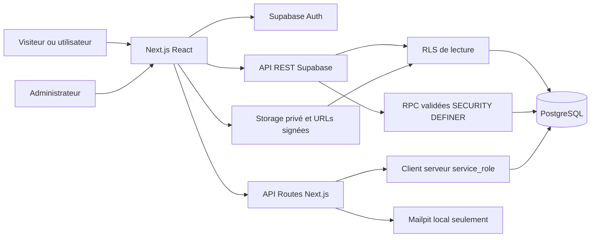
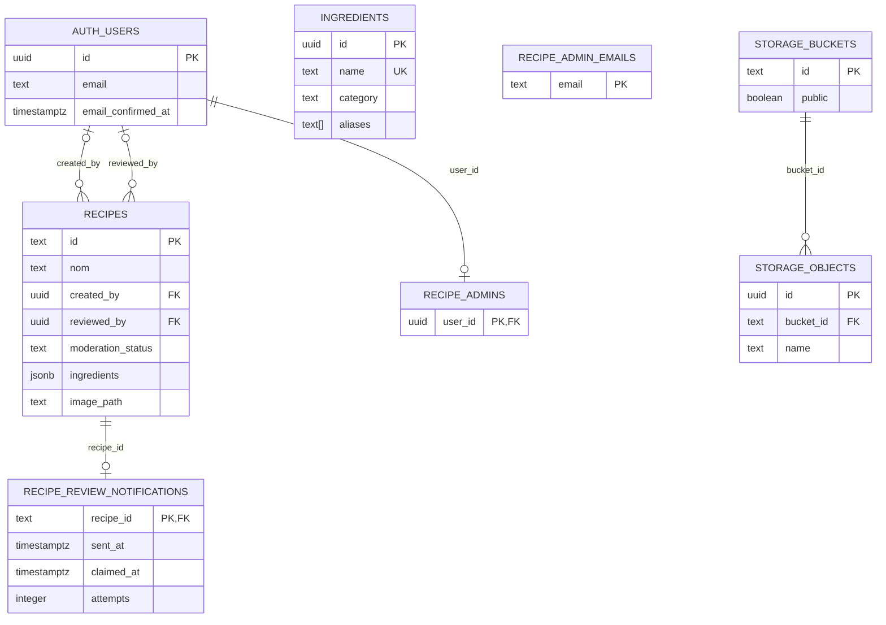

# Broco-Chou — Base de données et contrats backend

**Objectif :** Référencer le schéma versionné, ses permissions et les écarts observés dans Supabase Cloud.
**Dernière mise à jour :** 2026-10-17
**Statut :** EXISTANT reconstitué depuis les sept migrations ; CONFIGURÉ Cloud contrôlé en lecture seule.
**Documents liés :** [Architecture](TRD.md), [Parcours](APP_FLOW.md), [Roadmap](IMPLEMENTATION_PLAN.md), [Décisions](DECISIONS.md).

## Portée et divergence de production

**Ne pas assimiler le schéma versionné au schéma déjà déployé.** Audit du projet `cbwrvcifxcqyrgtcpvbd` via API de gestion, requêtes de métadonnées enveloppées dans `begin read only`, sans lecture de comptes ni de recettes privées. Région retournée : `eu-west-1`. Les preuves de session sont résumées dans le [journal](IMPLEMENTATION_PLAN.md).

| Migration | Effet versionné | Historique Cloud au 2026-10-17 |
| --- | --- | --- |
| `20260515000100_create_recipes.sql` | Recettes, ingrédients, index, trigger de date et lecture RLS | Présente |
| `20260515002000_sync_recipes_ingredients.sql` | Reprise facultative de `ingredients_catalog` dans `ingredients` | Présente |
| `20260820140000_allow_broco_chou_recipe_source.sql` | Contrainte source élargie, dont ancien `lumora` | Présente |
| `20260820143000_allow_instagram_recipe_source.sql` | Ajout source Instagram | Présente |
| `20261007190000_personal_recipes.sql` | Auteur, modération initiale, RPC, photos privées | Présente |
| `20261008120000_recipe_api_grants.sql` | Grants explicites de lecture et service | Présente |
| `20261016180000_recipe_review_workflow.sql` | Administrateurs par e-mail confirmé, édition pending, refus motivé, file et réservation | **Absente** |

Cloud contient `ingredients`, `recipe_admins`, `recipes`, avec RLS activée sur les trois tables (vérification de `pg_class.relrowsecurity`). Pas de `recipe_admin_emails`, `recipe_review_notifications`, `save_community_recipe`, `edit_pending_recipe`, `queue_recipe_review` ni `claim_recipe_notifications`. Les colonnes de `recipes`, index et policies initiales ont été observés. Le bucket privé et ses limites correspondent aux migrations initiales. Le trigger Cloud est seulement `set_recipes_updated_at`.

Conséquences : `submit_recipe` initial enregistre les recettes privées sans outbox ; l'administration distante dépend de `recipe_admins`, pas des adresses ajoutées par la migration du 16 octobre ; l'édition administrative est indisponible ; le commentaire de refus est exigé par l'UI récente mais pas par l'ancienne fonction SQL distante. Aucune migration distante appliquée ici.

Autre observation : les ACL Cloud accordent aussi `EXECUTE` à `anon` sur `submit_recipe`, `review_recipe`, `recipe_submission_authors`, en plus de `authenticated/service_role`. Les gardes internes Auth/admin continuent de s'appliquer. Les migrations retirent `PUBLIC` mais ne révoquent pas toujours les grants nominatifs hérités de l'environnement. Ne pas annoncer que le grant seul interdit toute invocation anonyme ; contrôler privilèges effectifs et gardes avant future migration.

## Architecture et relations



Diagramme du schéma **versionné complet** ; la divergence Cloud ci-dessus est explicite.



Les ingrédients sont imbriqués en JSONB, sans table de jointure ni FK vers `ingredients`. L'adresse administrateur se rapproche d'`auth.users.email` par fonction, sans FK. `recipes.image_path` référence conventionnellement `storage.objects.name`, sans FK. Les tables gérées par Supabase Auth/Storage ne sont pas redéfinies par l'application ; leurs colonnes citées sont les seules nécessaires aux contrats ci-dessous, pas un inventaire de leurs colonnes internes dépendantes de version.

## Tables publiques versionnées

Convention : « — » dans défaut = aucun défaut SQL ; « oui » dans NULL = valeur nullable. Les types et défauts viennent des [migrations](../supabase/migrations/).

### `public.recipes`

Catalogue éditorial et recettes communautaires ; les recettes préexistantes restent `approved`.

| Colonne | Type | NULL | Défaut / contrainte |
| --- | --- | --- | --- |
| `id` | text | non | — ; PK, identifiant fourni par import ou RPC |
| `nom` | text | non | — ; bornes appliquées par RPC, pas CHECK global |
| `description` | text | oui | — |
| `saison` | text | non | — ; `hiver/printemps/été/automne` |
| `mois` | text | non | — ; chaîne vide pour soumission |
| `mois_numero` | integer | non | — ; entre 1 et 12 |
| `semaine` | integer | oui | — |
| `jour` | text | oui | — |
| `tag` | text | non | — ; pas CHECK global |
| `categorie` | text | non | — ; `salé/sucré` |
| `theme_special` | text | oui | — |
| `portions` | text | non | — ; chaîne, pas une colonne numérique |
| `estimated_time` | integer | oui | — ; bornes RPC seulement |
| `difficulty` | text | oui | — ; `très facile/facile/intermédiaire` |
| `image_url` | text | oui | — ; sources historiques/locales |
| `ingredients` | jsonb | non | `[]` ; structure imposée par RPC pour communautaire |
| `instructions` | jsonb | non | `[]` |
| `astuce` | text | oui | — |
| `cuisson_micro_ondes` | boolean | non | `false` |
| `sans_four` | boolean | non | `false` |
| `source` | text | non | `crous` ; contrainte finale `crous/broco-chou/instagram/community` |
| `source_pdf` | text | oui | — ; peut aussi contenir URL source Instagram |
| `source_page` | integer | oui | — |
| `dietary_tags` | text[] | non | `{}` |
| `main_ingredients` | text[] | non | `{}` |
| `equipment` | text[] | non | `{}` |
| `canonical_ingredients_status` | text | non | `verified` ; `verified/partial/unknown` |
| `created_at` | timestamptz | non | `now()` |
| `updated_at` | timestamptz | non | `now()` ; trigger avant UPDATE |
| `created_by` | uuid | oui | — ; FK `auth.users(id)`, suppression par défaut NO ACTION |
| `moderation_status` | text | non | `approved` ; `pending/approved/rejected` |
| `reviewed_by` | uuid | oui | — ; FK `auth.users(id)`, NO ACTION |
| `reviewed_at` | timestamptz | oui | — |
| `moderation_note` | text | oui | — |
| `image_path` | text | oui | — ; chemin du bucket privé |

Index B-tree : `recipes_pkey(id)`, `recipes_saison_idx(saison)`, `recipes_mois_numero_idx(mois_numero)`, `recipes_categorie_idx(categorie)`, `recipes_source_idx(source)`, `recipes_creator_idx(created_by)`. Index GIN : `recipes_dietary_tags_idx(dietary_tags)`, `recipes_main_ingredients_idx(main_ingredients)`, `recipes_ingredients_idx(ingredients)`. Aucun index dédié `moderation_status` ou file pending dans ces migrations.

RLS activée ; policy SELECT **Published recipes or own submissions**, rôles `anon, authenticated`, condition : `moderation_status='approved' OR created_by=auth.uid() OR is_recipe_admin()`. Les trois opérations INSERT/UPDATE/DELETE directes sont révoquées pour ces rôles ; lecture explicitement accordée par la migration de grants. `service_role` dispose des droits privilégiés et contourne RLS. Les recettes rejetées restent visibles à l'auteur et aux administrateurs, sans publication.

### `public.ingredients`

| Colonne | Type | NULL | Défaut / contrainte |
| --- | --- | --- | --- |
| `id` | uuid | non | `gen_random_uuid()` ; PK |
| `name` | text | non | — ; UNIQUE |
| `category` | text | non | — ; pas de CHECK des six catégories |
| `aliases` | text[] | non | `{}` |
| `created_at` | timestamptz | non | `now()` |

Pas de `updated_at` malgré l'ancien modèle rédactionnel. Index : PK, UNIQUE `ingredients_name_key`, B-tree `ingredients_generic_key_idx(public.ingredient_key(name))`, non unique. RLS SELECT **Ingredients are readable with publishable key**, `using(true)` pour anon/authenticated. Écritures directes navigateur révoquées, `service_role` autorisé. La RPC peut ajouter un ingrédient sous verrou transactionnel de normalisation ; catégorie par défaut « Épicerie, condiments et produits sucrés » pour un nom inconnu. Les alias sont des tableaux texte ; la base ne valide pas un statut nutritionnel.

La deuxième migration ne crée pas `ingredients_catalog` : si cette table historique existe dans l'environnement, elle copie/upsert ses noms/catégories/alias. L'audit Cloud n'en a trouvé aucune. Ne pas la documenter comme table requise.

### `public.recipe_admins`

Une colonne `user_id uuid NOT NULL PRIMARY KEY REFERENCES auth.users(id) ON DELETE CASCADE`, sans défaut. RLS activée, aucune policy de navigateur ; INSERT/UPDATE/DELETE retirés à anon/authenticated, `service_role` autorisé. Gestion privilégiée par SQL. L'index PK couvre `user_id`. L'app ne permet pas de s'attribuer le rôle.

### `public.recipe_admin_emails`

Une colonne `email text NOT NULL PRIMARY KEY CHECK(email=lower(email))`, sans défaut. RLS activée, tous droits anon/authenticated révoqués, `service_role` autorisé. Seule la fonction administrateur accède au rapprochement. La migration contient deux adresses nominatives du propriétaire et d'un second administrateur ; ne pas les réutiliser comme données de test. Le seed **local uniquement** ajoute `admin@brocochou.com` sans créer de compte ni mot de passe. L'index PK couvre l'e-mail. Absente du Cloud audité.

### `public.recipe_review_notifications`

| Colonne | Type | NULL | Défaut / contrainte |
| --- | --- | --- | --- |
| `recipe_id` | text | non | — ; PK et FK `recipes(id) ON DELETE CASCADE` |
| `created_at` | timestamptz | non | `now()` |
| `sent_at` | timestamptz | oui | — |
| `claimed_at` | timestamptz | oui | — |
| `attempts` | integer | non | `0` ; pas de CHECK non-négatif |
| `last_error` | text | oui | — |

Outbox de nouvelle soumission, pas historique des décisions ni queue d'e-mails Auth. Index PK seulement. RLS activée sans policy de navigateur, tous droits anon/authenticated révoqués, tous droits accordés à `service_role`. Une ligne par recette, trigger transactionnel après INSERT et rattrapage des pending à l'application de la migration. Pas de suppression des lignes envoyées ni de planification cron. Absente du Cloud audité.

## Fonctions PostgreSQL et triggers

Signatures SQL finales après toutes les migrations, dans `public`. Les rôles ci-dessous décrivent l'usage autorisé par la conception et les GRANT explicites ; les privilèges hérités par défaut doivent aussi être audités sur chaque environnement.

| Signature exacte | Retour | Sécurité et appel |
| --- | --- | --- |
| `set_updated_at()` | trigger | PL/pgSQL invoker, modifie `NEW.updated_at=now()` ; trigger `set_recipes_updated_at` BEFORE UPDATE FOR EACH ROW sur recipes ; pas `search_path` fixé dans cette fonction initiale |
| `ingredient_key(value text)` | text | SQL IMMUTABLE STRICT invoker, `search_path=''` ; minuscule, espaces normalisés et accents latins remplacés. Pas de restriction EXECUTE particulière dans la migration |
| `is_recipe_admin()` | boolean | SQL STABLE SECURITY DEFINER, `search_path=''` ; PUBLIC retiré, anon/authenticated accordés ; appelé par RLS, UI et autres fonctions |
| `submit_recipe(payload jsonb)` | text | SQL SECURITY DEFINER, `search_path=''` ; wrapper final de `save_community_recipe(payload,NULL)`. PUBLIC retiré, authenticated accordé par migration initiale ; appelé par formulaire |
| `save_community_recipe(payload jsonb, editing_id text DEFAULT NULL::text)` | text | PL/pgSQL SECURITY DEFINER, `search_path=''` ; exécution retirée à PUBLIC/anon/authenticated ; fonction interne du propriétaire SQL, appelée par wrappers |
| `edit_pending_recipe(recipe_id text, payload jsonb)` | text | PL/pgSQL SECURITY DEFINER, `search_path=''` ; PUBLIC retiré, authenticated accordé, garde admin et ID non NULL ; formulaire admin |
| `review_recipe(recipe_id text, decision text, note text DEFAULT ''::text)` | void | PL/pgSQL SECURITY DEFINER, `search_path=''` ; PUBLIC retiré, authenticated accordé ; garde admin ; boutons de modération |
| `recipe_submission_authors()` | TABLE(user_id uuid, email text) | PL/pgSQL STABLE SECURITY DEFINER, `search_path=''` ; PUBLIC retiré, authenticated accordé, vérification admin avant lecture `auth.users` ; UI de modération |
| `queue_recipe_review()` | trigger | PL/pgSQL SECURITY DEFINER, `search_path=''` ; après INSERT recipes, ajoute outbox pour `community/pending`, `ON CONFLICT DO NOTHING`. Pas de révocation EXECUTE explicite, pas RPC métier appelable utilement hors trigger |
| `claim_recipe_notifications(target_id text DEFAULT NULL::text)` | SETOF public.recipe_review_notifications | SQL SECURITY DEFINER, `search_path=''` ; PUBLIC/anon/authenticated retirés, service_role accordé ; serveur de notification seulement |

### Gardes et effets

`is_recipe_admin` final exige une ligne `auth.users` du uid courant avec `email_confirmed_at IS NOT NULL`, puis membership `recipe_admins` ou e-mail minuscule dans `recipe_admin_emails`. L'ancienne fonction Cloud vérifie uniquement l'appartenance `recipe_admins` ; la confirmation est alors imposée par Auth pour la connexion habituelle, pas par cette fonction.

`save_community_recipe` exige `auth.uid()` non NULL. En édition : admin obligatoire et verrou `FOR UPDATE` sur recette `community/pending`, sinon exception. Champs validés : nom trim 2–150, description ≤2000, tableaux ingrédients/étapes, 1–60 ingrédients, 1–50 étapes texte trim 1–2000, tags `dejeuner/diner`, `petit_dejeuner`, `dessert`, `aperitif`, durée 1–1440, portions 1–50. Chaque ingrédient : nom normalisé 1–120, quantité ≤40, unité ≤30. Saison/catégorie restent contraintes par la table ; casts numériques invalides échouent transactionnellement.

L'upload doit déjà exister dans le bucket et appartenir au uid ; en édition, la photo originale peut être conservée même si elle appartient à l'auteur. Les ingrédients sont rapprochés par `ingredient_key(name)` ou alias ; `pg_advisory_xact_lock(hashtextextended(...,0))` sérialise les créations de même nom, choix du premier par `created_at,id`. Le JSON enregistré inclut nom canonique, quantité, unité, catégorie et `canonical:true`.

Nouvelle recette : identifiant `community-<uuid>`, source `community`, auteur `auth.uid()`, `pending`, difficulté `facile`, `mois=''`, mois numérique courant du serveur, statut canonique `verified`. Les champs équipement/tags restent leurs défauts s'ils ne sont pas remplis par la RPC. En édition : nom, description, saison, tag, catégorie, portions, durée, ingrédients, instructions, image_path changent ; auteur et statut sont conservés. Aucun traitement de nettoyage des anciennes photos dans SQL.

`review_recipe` final n'accepte que `approved/rejected`, note ≤1000 et commentaire trim non vide si refus. UPDATE seulement pour `community/pending` ; stocke décision, note trim, uid du reviewer et date. Si déjà traitée/introuvable, exception ; concurrence sérialisée par UPDATE, une décision gagne. Pas de journal séparé de toutes les révisions. L'ancienne version Cloud n'oblige pas la note de refus.

`claim_recipe_notifications` réserve au maximum 20 recettes encore pending, non envoyées, avec réservation absente ou vieille de cinq minutes, option `target_id`. Ordre création, `FOR UPDATE ... SKIP LOCKED`, `claimed_at=now()`, `attempts+1`. Les appels répétés ne resoumettent pas une recette et ne renvoient pas une notification déjà marquée `sent_at`. Une coupure après livraison mais avant horodatage peut encore provoquer un doublon lors de la reprise : pas de garantie exactly-once.

Les fonctions definer valident explicitement uid/admin, utilisent les noms de schéma qualifiés et le chemin de recherche vide. Elles contournent RLS avec leurs droits propriétaires pour les seules opérations prévues. Ne pas ajouter de SQL dynamique ni accorder `save_community_recipe` au navigateur.

## Storage et Auth

Bucket versionné et observé en Cloud : `recipe-photos`, privé, limite `5242880` octets (5 Mio), MIME `image/jpeg`, `image/png`, `image/webp`. Chemin UI : `<uid>/<uuid>.<jpg|png|webp>`. Pas de policy UPDATE ; la photo est remplacée par un nouvel objet.

| Policy `storage.objects` | Opération / rôles | Condition |
| --- | --- | --- |
| Upload own recipe photos | INSERT / authenticated | Bucket attendu et premier dossier = `auth.uid()` |
| Read visible recipe photos | SELECT / anon, authenticated | Dossier propre, administrateur ou photo référencée par une recette approuvée |
| Remove unused own photos | DELETE / authenticated | Dossier propre et aucun lien `recipes.image_path` |

La condition de suppression utilise les recettes visibles par RLS dans la sous-requête ; elle n'est pas une FK interdisant tout orphelin. Un fichier remplacé appartenant à l'auteur ne devient pas supprimable par un autre administrateur via la policy actuelle. Les URL signées expirent après 7200 s, recréées au chargement et aux rafraîchissements du catalogue. Elles sont des capacités temporaires : ne pas les partager comme preuves publiques d'une soumission privée.

`auth.users` est géré par Supabase, pas par une table profils publique du projet. Colonnes utilisées : `id`, `email`, `email_confirmed_at`. `created_by/reviewed_by` pointent sur `id`. La suppression d'un compte peut être bloquée par ces FK ; ne pas promettre une suppression automatique de toutes ses recettes ou photos. Le seed d'admin ne crée pas d'utilisateur Auth. Le navigateur utilise le SDK partagé avec stockage de session local et refresh automatique par défaut ; clé Auth locale distincte `broco-chou-supabase-local-auth`, session Cloud séparée. Les méthodes et redirections sont documentées dans [APP_FLOW](APP_FLOW.md) et [TRD](TRD.md).

## Contrats des API Next.js

### `POST /api/recipe-import/parse`

Sans Auth ; entrée JSON `{caption:string}`. Découpe ingrédients/préparation par titres reconnus et regex, nettoie puces/numérotation, infère un titre ; pas de scraping ni LLM. Sortie 200 `{title,ingredients:[{name,quantity?}],instructions:string[],description}` (description tronquée à 500). 400 si légende vide ; JSON invalide/type incorrect peut produire 500 non maîtrisé. Aucun plafond de taille ou rate limiter dédié. Source : [parse/route.ts](../app/api/recipe-import/parse/route.ts).

### `GET /api/recipe-import/images?query=<texte>`

Sans Auth ; runtime Node, lit `public/assets/recipe_images/pexels`, classe fichiers jpg/jpeg/png par tokens du nom, retourne six résultats même si pertinence faible. 200 `{photos:[{id,alt,photographer,photographer_url,url,src:{large}}]}` ; ID texte de fichier local, URL relative, photographe générique. 400 si recherche vide ; erreur disque potentiellement 500. La page utilise un type Photo avec ID numérique historique sans validation runtime ; pas d'appel Pexels ni clé API requise. Source : [images/route.ts](../app/api/recipe-import/images/route.ts).

### `POST /api/recipe-import/save`

Refus 403 si `NODE_ENV==='production'`, y compris Preview. En développement : **aucune Auth ni garde loopback**. Clé serveur `SUPABASE_SERVICE_ROLE_KEY`, URL `NEXT_PUBLIC_SUPABASE_URL` ; le choix d'environnement est donc critique. 500 si configuration absente.

Entrée `{title,description?,sourceUrl,imageUrl,ingredients:[{name,quantity?}],instructions:string[]}`. Valide titre, préfixe `https://www.instagram.com/`, image non vide et au moins un ingrédient ; pas de validation complète de types/tailles. Génère `instagram-<slug>-<uuid8>`, mois/saison courants, `dejeuner/diner`, `salé`, portions `À préciser`, difficulté `facile`, canonique `partial`. POST REST vers `public.recipes` avec service_role ; défaut SQL `approved`. 200 `{recipe:<ligne SQL>}` ; erreur REST avec même statut et message générique ; types mal formés potentiellement 500. Source : [save/route.ts](../app/api/recipe-import/save/route.ts). Cet outil ne suit pas la modération communautaire.

### `POST /api/recipe-notifications`

Runtime Node ; `Authorization: Bearer <access_token>`. Le serveur crée un client service_role, vérifie le token par `auth.getUser(token)`, puis la propriété de `recipeId`. JSON `{recipeId:string}` au plus 100 caractères. 401 sans jeton/jeton invalide, 400 identifiant invalide, 403 recette absente/non possédée ; 503 configuration/transport indisponible. 200 `{processed:number,failed:number}` ou 503 si certains envois échouent. JSON illisible devient entrée invalide, pas une exécution SQL.

`sendRecipeNotifications` n'envoie qu'hors production vers Supabase loopback. RPC claim puis requête Mailpit `http://127.0.0.1:54324/api/v1/send` avec timeout 10 s, destinataire local `admin@brocochou.com`, lien `http://localhost:3000/?review=<id>`, objet « Nouvelle recette à valider ». Marque `sent_at` après envoi, `last_error` générique en échec. Le formulaire appelle automatiquement seulement en développement loopback après le nettoyage ; Cloud ne reçoit aucun e-mail de modération et la file versionnée demeure sans purge. Sources : [route](../app/api/recipe-notifications/route.ts), [service](../lib/recipe-notifications.ts).

### `GET /api/recipe-notifications`

Exige `CRON_SECRET` défini et exactement le Bearer correspondant ; sinon 401. Aucun payload ; traite jusqu'à 20 tâches, mêmes résultats 200/503. Reprise locale manuelle possible ; aucun ordonnanceur dans `vercel.json`. Conserver un secret serveur distinct d'une clé Supabase. Ne pas configurer un cron de production pour un transport local.

## Imports, seeds, sauvegarde et restauration

`supabase/seed.sql` est un artefact de reconstruction locale pouvant contenir `truncate`. `seed-local-admin.sql` est explicitement local. Aucun des deux ne doit être exécuté sur Cloud. Les JSON/SQL sous [new-import](../supabase/new-import/) sont des artefacts métier conservés ; des scripts peuvent produire des upserts qui modifient des recettes existantes. Réimporter un lot n'est pas une simple vérification.

Générateurs : `generate-supabase-seed.mjs` extrait les mocks via `vm`, `generate_supabase_seed_from_sources.py` reconstruit depuis des sources externes à inspecter, `inspect_xlsx_xml.py` inspecte XLSX/XML, `generate-city-cafe-import.mjs` produit les lots et attributions. Les chemins de sources ne sont pas supposés portables ; lire les scripts avant toute génération pour ne pas écraser le seed. `verify-city-cafe-sync.mjs` lit les deux bases, compare 157 IDs et champs métier/catégories, nécessite Docker et une clé privilégiée distante ; ne fait pas d'écriture. Les fichiers de correction SQL et attributions restent conservés.

Procédure privilégiée historique, **à ne pas exécuter sans accord** : préparer une transaction ciblée, confirmer le projet dans `.temp/linked-project.json`, sauvegarder base et médias, vérifier les droits, appliquer l'import avec la CLI compatible (`db query --linked --file ...` dans l'ancien guide), vérifier ensuite par SELECT de l'ID/source/portions. Une nouvelle source exige une nouvelle migration ; `db push` déploierait toutes les migrations en attente, dont le workflow manquant. Jamais de `truncate` Cloud, de reset distant ou de seed local sur le projet lié. La mission actuelle se limite aux lectures.

Modèle d'import historique, repris du README : les colonnes facultatives omises prennent NULL ou leur défaut indiqué plus haut ; l'identifiant et la provenance doivent être stables et relus. Les écritures manuelles de catalogue privilégiées sont distinctes des RPC communautaires.

```sql
begin;
insert into public.ingredients(name, category, aliases)
values ('ingrédient principal', 'Fruits, légumes et légumineuses', array['alias éventuel'])
on conflict (name) do nothing;

insert into public.recipes (
  id, nom, description, saison, mois, mois_numero, semaine, jour, tag,
  categorie, theme_special, portions, estimated_time, difficulty, image_url,
  ingredients, instructions, astuce, cuisson_micro_ondes, sans_four, source,
  source_pdf, source_page, dietary_tags, main_ingredients, equipment,
  canonical_ingredients_status
) values (
  'instagram-nom-recette-identifiant', 'Nom de la recette', 'Description courte.',
  'été', 'juin', 6, null, null, 'dejeuner/diner', 'salé', null,
  '2 personnes', 30, 'facile', '/assets/recipe_images/pexels/nom-recette.jpg',
  '[{"name":"ingrédient principal","quantity":"200","unit":"g","canonical":true}]'::jsonb,
  '["Première étape.","Deuxième étape."]'::jsonb, 'Astuce facultative.', false, true,
  'instagram', 'https://www.instagram.com/p/identifiant/', null,
  array['végétarien'], array['ingrédient principal'], array['saladier','poêle'], 'partial'
);
commit;
```

`recipes.created_at/updated_at` et `ingredients.id/created_at` sont générés ; `ingredients.updated_at` n'existe pas. L'ancienne valeur `lumora`, temporairement acceptée par les migrations d'août, n'est plus admise par la contrainte finale.

Sauvegardes hébergées, rétention et restauration effective : [À CONFIRMER], aucune promesse liée à Supabase Free. Avant une future écriture distante : définir export SQL sécurisé, copie des objets Storage et registre des versions ; tester restauration dans une cible isolée, sans toucher à la production. Un dump SQL ne sauvegarde pas les octets des photos et le dépôt ne sauvegarde pas les plans localStorage. Aucun test de restauration effectué pendant cette mission.
